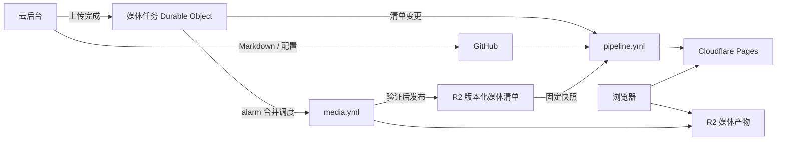

<div align="center">


# Mosaic

**你的个人 B 站 —— 一个以媒体为第一公民的静态站点生成器与内容平台**

Markdown 写故事，照片 / 视频 / 音乐做主角。
0 成本 · 云端管理 · 零运维 · 纯静态 · 开箱即用。

[](https://github.com/YupenBob/mosaic/actions/workflows/pipeline.yml)
[](https://github.com/YupenBob/mosaic/actions/workflows/health-check.yml)
[](#协议)
[](https://mosaic.xsanye.cn)

**English** · [README_EN.md](README_EN.md)

</div>

---

## 是什么

Mosaic 是一个**多媒体优先的静态站点框架**：像 Hexo 一样用 Markdown 写作，但不是"挂 MP4 的博客"——照片画廊、多码率 HLS 视频、音乐播放器生来就是平台的主角。

它把"内容创作 → 媒体处理 → 静态发布 → 数据统计"整条链路做成一个可复用的框架：内容在 Git，媒体在 Cloudflare R2，计算在 GitHub Actions，展示在 Cloudflare Pages，管理在原生 JS 云后台。**未来成百上千用户开箱即用**是每一处设计的出发点。

## 特性一览

### 创作与发布

| 能力 | 说明 |
| --- | --- |
| Markdown 写作 | YAML frontmatter 驱动，布局 / 封面 / 视频模式 / 多级分类随意编排 |
| 媒体原生支持 | 图片、视频、音乐一视同仁，是内容模型的一等公民 |
| 预签名直传 | 浏览器直连 R2 上传（单文件可达 5GB），不再经服务器中转；>100MB 自动分片上传（并发 + 每片重试 + 断点续传） |
| 媒体管线 | 图片 → WebP 多档、视频 → HLS 多码率、音乐 → MP3 128k/320k + 波形峰值 + 封面/元数据，全自动 |
| EXIF 隐私 | 管线自动剥离原图 EXIF（GPS 等），隐私由设计保证 |
| 一键发布 | 管理后台保存 → 构建 → 部署，全程无需命令行 |

### 观看体验

| 能力 | 说明 |
| --- | --- |
| 大卡片 / 全图卡片 | 每列首尾相接的瀑布流（卡片高度随封面比例），封面 full-bleed 全图；几 KB 预览图先占位、高清图就绪后原位替换；类小米超椭圆圆角（支持的浏览器连续曲率，其余回退大圆角）；文字卡自动紧凑降级 |
| 开放主题模式 | 自动 / 亮 / 暗三态 + 6 套主题色，首帧无闪烁，后台配置默认值与访客切换权限 |
| 详情弹层 | 类小红书：点击卡片原地弹出详情（图集 / 视频 / 音乐 / 正文），URL 可分享、刷新直达、Esc/返回键关闭 |
| 竖屏刷视频 | 类抖音全屏 feed：滚轮/触摸/键盘切换、一次只播一个、预载相邻、双击点赞、单击暂停、静音自动播放 |
| Spring 动效 | 统一 rAF spring 动效（snappy/smooth/bouncy），尊重系统减弱动效设置 |
| Morphicons 图标 | 交互图标状态间形变（主题日月、播放暂停、点赞等），无 CDN、随包发布 |
| 照片画廊 | 4 档清晰度（480p/720p/1080p/原图）、LQIP 渐进加载、滚轮缩放、胶片导航、切档保留缩放 |
| 视频播放器 | 统一解码 flow 状态机：点击才触发解码/分片、首点不再被吞、HLS 多码率 ABR、手动切档、倍速、PiP、播放列表、致命错误自动降级 MP4 |
| 播放流畅 | 最低档起步快速升档、按设备/网络自适应缓冲、弱网降档、后台标签暂停、离开页面保存进度 |
| 音乐播放器 | 列表播放、128k/320k 码率、封面/时长/波形、mini 播放器、锁屏媒体会话（Media Session） |
| 搜索与筛选 | 全文搜索、分类 / 标签瀑布流卡片 |
| 暗色模式 / i18n | 跟随系统，中英双语 |
| RSS / Sitemap / 评论 | 自动生成 feed 与站点地图，Giscus 评论开箱即用 |

### 云管理后台

| 能力 | 说明 |
| --- | --- |
| 原生 JS SPA | 模块化源码，发布时生成带内容版本的单个 ESM 入口 |
| 仪表盘 | 流量曲线、分类/标签真实统计、热门文章、存储用量、系统健康 |
| 构建中心 | 独立媒体任务与站点部署进度、重试/取消、失败详情 |
| 编辑器 | Markdown 实时预览、自动保存草稿、封面上传、媒体拖拽上传（并发 + 重试） |
| 站点配置 | 全部配置可视化编辑：主题模式/主题色、卡片布局（瀑布流/网格）与体验开关、补帧参数、保留源文件、画质 / 转码 / 媒体重试 / 保留策略 / favicon |
| 视频补帧 | 后台一键“后补帧”：对已完成解码的视频从已发布档位重编码（ffmpeg 光流 minterpolate），支持单条/整篇/全部，带进度、失败重试与成本提示 |
| 源文件管理 | 全局与逐次上传可选“解码后保留源文件”；删除后标记不可从源重转码，仍可基于已发布产物后补帧 |
| 效率工具 | 命令面板（Ctrl/Cmd+K）、快捷键、三态主题、回收站、危险操作确认、骨架屏与局部重试 |

### 工程与运维

| 能力 | 说明 |
| --- | --- |
| 增量构建 | 站点读取版本化清单；上传自动触发独立增量媒体任务 |
| 并发安全统计 | 浏览量/点赞/停留时长由 Durable Object 串行写入，杜绝丢失 |
| 零成本可观测 | 构建进度实时上报、生产健康检查定时巡检、全链路自动化测试 |
| 安全默认 | JWT 鉴权 + 登录限流、track 端点全局限流（Durable Object）、上传大小/类型白名单、fail-closed 配置、密钥隔离 |
| 国内可用 | Pages Functions 代理绕过 workers.dev、字体/图表全自托管 |

## 架构与媒体处理



媒体处理与站点构建分别使用工作流及并发组。上传完成会自动登记持久化任务；媒体任务只下载当前变更文件，处理图片、视频或音频。站点构建只读取 Markdown、配置、模板与媒体清单，不下载原文件、不执行 FFmpeg、不等待高档转码。

视频可选 **ffmpeg 光流补帧**（`minterpolate`，默认关闭）：转码时单遍生成高帧率档位；已解码视频可在后台“后补帧”，从已发布 MP4 重编码而不重新下载源文件。媒体任务协调器持久化调度状态机（`mediaDispatch`），只在确实有到期任务且没有排队/运行中的媒体 run 时派发工作流，runner 中断会自动恢复，避免重复排队或漏触发。解码成功后可选删除 R2 源文件（后台明确警示不可逆）。

首次上传显示处理中占位，同名替换继续使用上一份可播放产物。视频按从低到高的档位处理，已验证的低档先发布，高档通过断点自动续跑。每次增加档位创建新的 master 清单，旧部署的地址保持有效。

清单保存媒体 ID、源 ETag、源版本、配置指纹、实际对象键和元数据。过期任务回调由任务 ID、运行 ID、租约与 generation 拦截；浏览器轮询不能清除脏标记。部署成功只确认本次 Git SHA 和清单版本覆盖的变更。

## 快速开始

```bash
git clone https://github.com/YupenBob/mosaic.git
cd mosaic
npm install
npm run build         # 生成静态站点
npm run serve         # 预览 http://localhost:3000
npm run check         # 语法 + config 校验 + worker/build smoke
npm run validate      # 校验 mosaic.config.json 与文章 frontmatter
npm run lint          # ESLint（0 警告）
npm run test:e2e:local# 本地静态预览 E2E（先 npm run build）
```

> 从零到线上（Cloudflare 配置、Secrets、首次部署）见 **[docs/SETUP.md](docs/SETUP.md)**

## 写文章

```
content/posts/my-post/
  ├── index.md       # Markdown + YAML frontmatter
  ├── photos/        # 图片原片
  ├── videos/        # 视频原片
  └── music/         # 音频原片
```

```yaml
---
title: "我的摄影故事"
date: 2026-05-01
category: photography/nature   # 支持多级分类
tags: [风光, 旅行]
description: "一场影像之旅。"
cover: cover.jpg
video_mode: stacked           # stacked | playlist
---
```

## 云管理后台

部署在 `mosaic-admin.xsanye.cn`，登录即用。v0.9 起采用 ES Module 架构（每页一个模块），提供仪表盘、文章管理、可视化编辑器、构建中心（步骤级进度 + ETA）、站点配置、分类标签管理、清理与回收站。支持命令面板、键盘快捷键、三态主题与中英双语。

## Worker API

按需认证分组的 REST API（详见 [handover.md](handover.md)）：

- **公开**：`/api/health`、`/api/stats/traffic`、`/api/stats/:slug`、`/api/track/view|like|dwell/:slug`、`/api/media/file/:slug/:filename`
- **需认证**：文章 CRUD 与分页、配置读写、构建触发 / 状态 / 历史 / 进度、分类标签（重命名/删除）、媒体列表与删除、后补帧（`GET/POST /api/media/interpolate`）、存储用量、孤儿清理、脏标记、批量文章统计

## 性能与可靠性设计

- **统计并发**：视图/点赞/停留时长写入 Durable Object 串行化，迁移自 R2 历史数据
- **构建与处理解耦**：内容更新不下载或处理原始媒体；`posts-index.json` 不包含正文、媒体数组与波形。测量见 [性能记录](docs/performance.md)
- **上传直达**：预签名 URL 让浏览器直连 R2，绕开 Worker 中转与平台 100MB 限制
- **播放可靠**：统一解码 flow 状态机，点击才加载（未点击零分片请求），HLS 直连 + 确定性 CORS，ABR 按带宽/播放器尺寸自适应，致命错误降级 MP4，首点意图重放
- **媒体调度可靠**：持久化 `mediaDispatch` 状态机跟踪 GitHub Actions run，避免重复排队与漏触发；预算中断可续跑
- **自动化守护**：管线内置单元/冒烟/真实 FFmpeg 补帧测试；每 6 小时生产健康巡检，异常即告警

## 项目结构

```
├── content/posts/            # 文章（Markdown + 媒体原片，Git 管理文本）
├── scripts/                  # 构建脚本：site/ (generation) + media/ (processing) + lib/ (shared context)
├── src/                      # 前台模板（EJS）与前端资源
│   ├── layouts/              #   index / post / 404 模板
│   ├── assets/js/            #   cards / motion / icons / note / feed / gallery / video / music ...
│   ├── assets/css/           #   设计令牌与组件样式
│   └── data/                 #   i18n 词典
├── worker/                   # Cloudflare Worker API（Hono + DO）
│   ├── src/                  #   index / auth / github / r2 / stats-do
│   └── scripts/              #   元数据迁移与 SDK 视频上传器
├── cloud-admin/              # 云管理后台（模块化 Vanilla JS SPA 源码）
├── functions/                # 前台 Pages Functions 代理
├── tests/                    # E2E / 冒烟测试（Playwright + Node）
├── docs/                     # 架构 / 配置 / 媒体 / 音乐 / 迁移 / 搭建文档
├── mosaic.config.json        # 站点配置
└── .github/workflows/        # pipeline（站点）+ media（媒体）+ infrastructure + verify + health-check
```

## 部署

1. 配置 Cloudflare（R2 桶 + Pages 项目 + Worker）
2. 部署 Worker：`cd worker && npx wrangler deploy`
3. 打包并部署管理后台：`node scripts/stage-admin.mjs`，然后 `npx wrangler pages deploy .mosaic/admin-dist --project-name mosaic-admin`（项目名按配置调整）
4. 配置 GitHub Actions Secrets（R2 凭证、CF 令牌、Worker Secrets）
5. 按 [迁移指南](docs/migration.md) 先部署任务 Worker、迁移清单，再启用独立工作流；纯内容 push 只构建站点

完整步骤与秘钥清单见 **[docs/SETUP.md](docs/SETUP.md)**。

## 文档

- [架构设计](docs/architecture.md)
- [站点配置](docs/configuration.md)
- [媒体指南](docs/media-guide.md)
- [音乐指南](docs/music-guide.md)
- [迁移指南](docs/migration.md)
- [交互级提议](docs/interaction-proposals.md)
- [Experience v2 协作契约](docs/experience-v2-plan.md)
- [2026-10-01 上线与验收记录](docs/rollout-2026-10-01.md)
- [交接文档](handover.md)

## 路线图

- [x] 媒体域 Transform Rule：恢复边缘缓存的同时保证 CORS（视频播放延迟进一步下降）
- [x] 音乐播放器波形可视化（独立音频处理器生成 peaks，前端画布渲染 + 点击跳转）
- [x] 移动端 HLS 自动化矩阵（Chromium/WebKit × iPhone/Pixel/小屏视口）
- [ ] 真机 HLS 验证（iOS Safari / Android Chrome 实体设备，手动）
- [x] 管理后台构建页合并为单视图（概览/状态/历史同屏、实时轮询、失败定位）
- [x] 前台/后台可访问性（axe-core 双主题扫描已入 CI，前后台 0 违规）
- [x] 上传器并发提升与断点续传（>100MB 自动分片，3 并发 + 每片重试 + 断点续传）
- [x] 大卡片全图 + 开放主题模式 + Spring 动效 + Morphicons 图标
- [x] 瀑布流卡片（每卡独立高度）+ 几 KB LQIP 预览图优先加载 + 类小米超椭圆圆角
- [x] 类小红书详情弹层（不跳转、可分享、深链直达）与类抖音竖屏刷视频模式
- [x] 视频解码 flow 修复（首点意图重放、点击前零请求）与播放流畅度优化
- [x] ffmpeg 光流补帧（转码时 + 已解码视频后补帧）与解码后源文件保留选项
- [x] 媒体工作流触发可靠性（持久化调度状态机、防重复排队、断点续跑）

## 协议

[MIT](LICENSE) © Mosaic Contributors

实际交互优化：前台发布单一脚本包；后台操作无需等待统计，上传回执保留任务状态，确认失败可直接重试。视频使用 CORS 请求、按需分片和稳定断点恢复。详见 [体验排查与验证](docs/experience-2026-10-02.md)。
