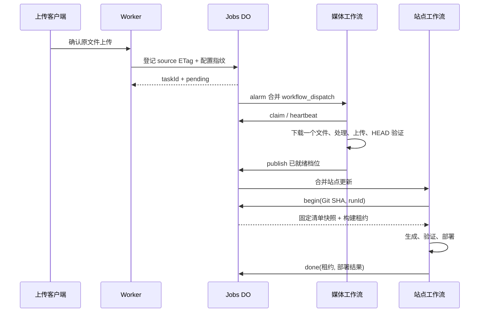

# Mosaic 架构

内容存于 Git，原文件与处理产物存于 R2；Node.js / EJS 生成静态站点，Hono Worker 提供内容、上传、统计与任务接口。前台和后台保持原生 ES Module，无框架迁移。

## 模块边界

| 层 | 模块 | 职责 |
| --- | --- | --- |
| 共享契约 | `shared/config.mjs`、`shared/media-manifest.mjs` | 默认值、兼容映射、校验、媒体身份与配置指纹；主题 / 体验 / 补帧 / 源文件保留开关 |
| 站点 | `scripts/site/{posts,media,indexes,render,generate}.mjs` | Markdown 解析、清单映射、复用分类标签索引、缓存 EJS 模板、清空输出 |
| 站点数据 | `scripts/site/experience-data.mjs` | 生成 `feed.json` 与按篇 `notes/{slug}.json`（弹层/竖屏模式按需读取） |
| 卡片渲染 | `src/assets/js/cards/{render,media,masonry}.js` | 纯 ESM 卡片标记唯一来源 + LQIP 渐进升级 + 跨浏览器 JS 瀑布流打包 |
| 体验层 | `src/assets/js/{motion,icons,note,feed}/**` | Spring 动效、Morphicons 图标、小红书式详情弹层、抖音式竖屏流 |
| 媒体 | `scripts/media/{images,videos,audio,preview}.mjs`、`scripts/media/video-{filter,source}.mjs` | 隐私处理、压缩、波形和音乐元数据；几 KB 预览图；补帧滤镜与“源/已发布产物”两种解码入口 |
| 媒体执行 | `scripts/media/{run,storage,process}.mjs` | 单文件下载、流式哈希、租约心跳、存储与进程管理 |
| Worker 服务 | `worker/src/services/`、`worker/src/jobs/**` | GitHub 内容、配置、工作流、发布状态、媒体登记与引用保护；任务调度/补帧登记 |
| Worker 路由 | `worker/src/routes/` | 鉴权、参数、响应与服务编排；新增 `/api/media/interpolate` |
| 后台 | `cloud-admin/js/{router,lifecycle,editor,upload,jobs,build}.js`、`cloud-admin/js/config/**` | 路由、退出清理、编辑、上传、媒体任务和部署状态；配置分区与表单构建器 |
| 视频前台 | `src/assets/js/video/{playback,flow,tune,hls-loader,player,controls,playlist,registry}.js` | 统一解码 flow 状态机、HLS/MP4 回退、ABR、播放器 UI、播放列表与实例管理 |

`StatsDurableObject` 的类名、绑定、命名空间与 v1 迁移保留。新增 `JobsDurableObject` 使用独立 JOBS 绑定和 `v2-media-jobs` 迁移；统计数据不会被新任务状态覆盖。

## 体验层（Experience v2）

前台仍是原生 ESM、无框架，发布时由 esbuild 打包成单一入口。体验能力全部可配置关闭：

- **卡片**：`src/assets/js/cards/render.js` 是唯一标记来源，SSG 通过 `render.mjs` 注入 EJS，
  过滤/搜索复用同一模块。**默认瀑布流**：CSS 多列负责无 JS 回退，`cards/masonry.js` 在
  水合后按“最短列”绝对定位打包（规避 WebKit 对 aspect-ratio 卡片的分栏错误）；每张卡片
  高度由封面比例决定（夹取 0.62–1.5），文字卡保持内容高度。`experience.card.layout='grid'`
  可切回等高网格。
- **图片加载**：列表/卡片先加载几 KB 的 LQIP（图片 placeholder、视频 `poster-preview.webp`、
  音乐 `cover-preview.webp`），`cards/media.js` 在视口接近或首屏优先时 `Image.decode()` 后
  原位替换高清图；alt/srcset/noscript 回退完整，`saveData`/`prefers-reduced-data` 时保留预览。
  封面比例在 SSR 内联为 `--cover-aspect`，图片加载前后无 CLS。
- **超椭圆圆角**：设计令牌放大圆角；支持 `corner-shape: squircle` 的浏览器（Chromium）
  呈现连续曲率，WebKit/Safari 回退为同半径普通圆角；不使用固定像素 `clip-path`/mask，
  避免阴影裁剪与响应式重算问题。
- **主题**：首帧内联脚本把偏好解析为 `data-theme`（light|dark，CSS 兼容）+ `data-theme-mode`
  （auto|light|dark，菜单状态）+ `data-accent`（色板）；后台可设默认值/是否允许访客切换。
- **Spring 动效**：`motion/` 提供 rAF spring 积分器与预设；`prefers-reduced-motion` 下退化为淡入。
- **Morphicons**：`icons/` 用 morphicons（MIT）在交互图标状态间做形变，静态装饰图标继续用
  RemixIcon；图标路径数据内联，无 CDN。
- **详情弹层**：点击卡片不跳转，按需读取 `data/notes/{slug}.json`，History API 维护
  `?note=slug`，焦点陷阱/滚动锁定/Esc/返回键/深链，失败时回退普通导航。
- **竖屏模式**：按需读取 `data/feed.json`（仅已发布视频的文章），全屏 scroll-snap，一次只播
  一个，预载相邻项；播放统一走下面的解码 flow 控制器。
- 媒体数据仍只在构建期由清单解析，弹层/竖屏数据是构建产物，不增加运行时 Worker 依赖。

## 视频解码 flow

`src/assets/js/video/playback.js` 是唯一的解码/加载状态机（idle → attaching → loading → ready
→ playing → stalled → recovering → fallback → destroyed）。HLS 与渐进 MP4 共用同一入口：
`attach` 只准备源，`play()`（用户意图）才触发 `startLoad` 与分片下载；HLS 致命错误按网络/媒体
类型恢复，超过重试次数降级 MP4；位置恢复键稳定，`destroy()` 幂等。播放列表、详情弹层和竖屏流
复用同一控制器，避免出现第二套“何时解码”的逻辑。`engine.js` 保留兼容导出，实际逻辑在
`playback.js` / `flow.js` / `tune.js` / `hls-loader.js`。

## 媒体 v2：补帧与源文件保留

- **转码补帧**：`videoQuality.interpolation` 启用时，每个档位在转码时追加 ffmpeg
  `minterpolate`（光流）单遍编码；禁用时该键从处理指纹移除，升级代码不会重转已有媒体。
- **后补帧**：`POST /api/media/interpolate` 登记 `options.sourceMode='processed'` 的任务，从已
  发布的档位 MP4 重新补帧/分片，不下载源文件，新 generation 发布前旧产物保持可用。
- **保留源文件**：`media.keepSourceFiles` / 任务级 `keepSource`；为 false 时协调器在全部档位
  发布成功后原子删除 `originals/...` 并标记 `source.available=false`，删除失败不影响发布。
- **调度触发**：DO 持久化 `mediaDispatch` 状态（idle/dispatching/active/retry + runId +
  backoff），只有存在到期 pending 任务、没有运行中任务且没有已确认的 active/queued 媒体 run
  时才 dispatch；budget 退出、retry、reconcile、config 变更都会重新排程 alarm，避免漏触发与
  重复排队。

## 两条计算链路

站点产物目录 `dist/` 每次清空。媒体工作目录位于系统临时目录或 `MEDIA_WORK_DIR`，不进入站点输出。`build-snapshot.json` 记录 Git SHA 与清单版本；模板、分类和标签索引在一次生成中复用。

## 任务与发布

任务状态为 pending、running、ready、failed、cancelled、superseded。上传登记在 R2 清单写入前先写 DO 存储；R2 或 GitHub 暂时不可用时，持久化 outbox 由 alarm 重试。租约到期进入有限重试，超过默认三次重试后由后台手动重试。

DO 将每个任务、媒体项与构建记录分开存储，分页恢复；状态变更与 alarm 在同一事务登记。配置变更保存补处理游标，alarm 按可配置批大小核验并排队；中断后继续，未变的处理指纹保持幂等。首次生产站点构建要求完成媒体导入，避免清单为空时覆盖旧站。

源 ETag 或处理配置指纹变化会生成新的 generation 并撤销旧租约。旧产物保留在 `asset.published`，首次上传才产生占位。低档 MP4、HLS 分片、播放列表和海报全部验证后发布；新增档位使用新 master 对象，旧 master 保持不变。

`/api/build/done` 是旧后台兼容探针，不能确认部署。内部回调用独立 `PIPELINE_SECRET` 的 HMAC 签名与时间窗鉴权，媒体再检查 taskId/runId/token/generation。内容脏状态与媒体变更分开记录，媒体任务不会使文章列表退回 N+1 次 GitHub 正文读取。

## 存储契约

- `originals/{slug}/{folder}/{filename}`：当前源文件。
- `processed/{slug}/{folder}/{generation}/...`：版本化产物。
- `site-data/media-manifest.json`：当前清单。
- `site-data/media-manifests/{revision}.json`：不可变发布快照。
- `site-data/posts-index.json`：部署后的精简列表缓存。
- `dist/data/posts.json`：保留一个兼容发布周期的完整旧入口。

清理保护当前有效清单、未完成任务断点、正在构建的快照和保留的成功部署。后台“处理缓存”操作改为重新排队，已有可用产物保留到引用释放与保留期结束。

现有 Pages IP 签名代理保持单一源文件及同步检查；目标域名必须通过 `API_TARGET` 配置。详见 [配置](configuration.md)、[迁移](migration.md)、[运维](operations.md)。

## 前台与后台请求边界

源码保持模块职责，发布阶段由 esbuild 将 app 依赖打包成一个 ESM 文件，消除串行模块下载。组件独立初始化；列表仍只读精简索引。视频使用显式跨域、按需分片、播放前布局占位与稳定媒体恢复键。后台 API 客户端管理在途请求、有限缓存、各消费者取消和超时；仪表盘按服务独立刷新。媒体列表由任务清单提供实际预览与显示顺序，不推断处理产物路径。

发布资源采用内容版本：前台 bundle 以 SHA-256 摘要命名并更新生成 HTML；后台由 scripts/stage-admin.mjs 将模块化源码打包为一个 ESM 入口，并在部署暂存目录写入一致内容版本。Chart.js、Markdown 与净化器按需加载。版本同时包含源码与编译产物，相同内容复用缓存键，依赖或编译产物变化使资源更新。Pages Function 不参与浏览器打包。
